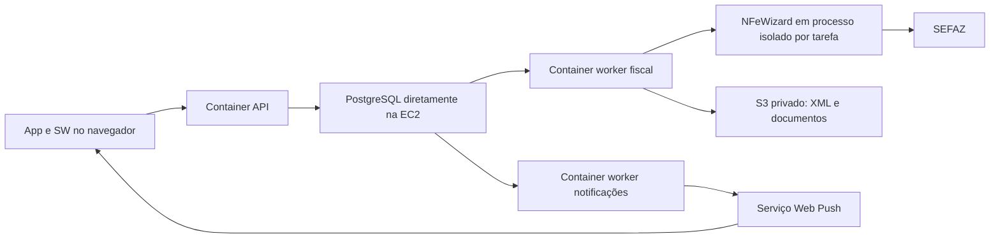

# Verificação de Docker, PWA, notificações e fiscal

**Atualização:** os workers PostgreSQL, Compose de produção, envio criptografado de certificado e cadastro fiscal já foram implementados. Consulte [a estrutura atual e o procedimento de implantação](WORKERS-PRODUCTION.md). O restante deste arquivo registra a inspeção anterior à implementação.

Verificado em 27/10/2026 nos projetos Ultragas. Este documento registra o estado
do código; não instala nem ativa serviços na hospedagem.

## Estado encontrado

| Componente | Legado MongoDB | Novo modo PostgreSQL |
|---|---|---|
| API em Docker | Há Dockerfile com build de dependências e execução como usuário `node`. | O mesmo entrypoint seleciona PostgreSQL com `DATABASE_ENGINE=postgres`. A imagem não foi construída/validada nesta verificação. |
| Compose | O Compose da raiz usa `./backend`, outro diretório; não orquestra especificamente o Ultragas. | Ainda não há Compose Ultragas separando API e workers. PostgreSQL permanece previsto diretamente na EC2. |
| Service worker | `public/sw.js` existe, é registrado no HTML, recebe push e exibe notificações. | O arquivo continua no app; o transporte backend PostgreSQL ainda não foi implementado. |
| Push backend | `web-push`, VAPID, registro de dispositivos, envio de teste e tratamento de assinaturas expiradas já existem. | Rotas e tabelas de notificações/assinaturas ainda não migradas. Prompt, sincronização e telas correspondentes estão desativados nesse modo. |
| Worker de notificações | Não há serviço independente nem fila durável de entregas. A API persiste a notificação e chama o transporte no próprio processo. | Não há worker/outbox implementados. |
| Worker de operações/fiscal | Loop interno na API, com tarefas persistidas no MongoDB e lease. Chama NFeWizard em processo filho por operação. | Não é iniciado pelo servidor PostgreSQL; não há fila fiscal migrada. |
| Emissão NFC-e do PDV | Endpoint real está bloqueado. Painel separado permite demo/homologação. | Fiscal está entre os módulos pendentes e retorna indisponibilidade, sem fallback ao MongoDB. |

A consulta `docker ps` não encontrou containers locais em execução neste momento.
Não foi verificado o processo ativo na hospedagem Render/AWS. Ter Dockerfile
não comprova que a implantação atual utiliza Docker.

## PWA e notificações

Arquivos confirmados:

- [Service worker](C:/Users/user/Desktop/projetos/Bansir/bansir-demo-ultragas-app/public/sw.js:82): handlers de `push`, `showNotification` e clique.
- [Registro do SW](C:/Users/user/Desktop/projetos/Bansir/bansir-demo-ultragas-app/index.html:34): `/sw.js`, com atualização sem cache.
- [Manifest](C:/Users/user/Desktop/projetos/Bansir/bansir-demo-ultragas-app/public/manifest.json): vinculado ao HTML, ainda com nome/identidade de artesanato do projeto original.
- [Cliente de push](C:/Users/user/Desktop/projetos/Bansir/bansir-demo-ultragas-app/src/services/push.js:4): permissão do usuário, chave pública VAPID e registro da assinatura.
- [Inscrição](C:/Users/user/Desktop/projetos/Bansir/bansir-demo-ultragas-app/src/utils/deviceHelper.js:101): `PushManager.subscribe`, reutilização e renovação da assinatura.
- [Entrega backend](C:/Users/user/Desktop/projetos/Bansir/bansir-demo-ultragas-backend/src/modules/notifications/notification.service.js:128): envio por `web-push` e remoção de assinaturas expiradas.

O service worker executa no navegador e recebe/exibe a mensagem enviada pelo
servidor via serviço de push. Ele não executa o processamento fiscal na EC2.
O fluxo existente exige HTTPS ou localhost, navegador compatível, permissão,
assinatura cadastrada e par VAPID válido. Essas condições reais não foram
validadas em um dispositivo/hospedagem nesta revisão.

Limitações encontradas:

- Não há retry durável de entrega: falhas transitórias são registradas, sem
  uma fila independente que retome cada envio após reinício da API.
- Destinatários do legado são filtrados por cargo/preferência, sem empresa ou
  estabelecimento. Esse serviço não pode ser transplantado inalterado.
- O clique no SW apenas foca uma janela ou abre `/`; não utiliza o destino
  específico do documento/notificação nem confere a unidade do evento.
- A assinatura de push pertence ao registro do service worker/navegador, não
  ao token armazenado por aba. A migração precisa de uma política explícita
  de vínculo entre endpoint, usuário e unidades autorizadas.
- Notificação recebida não deve trocar o estabelecimento silenciosamente. Se
  o destino exigir outra unidade, o acesso deve passar pela seleção autorizada.

## Processamento fiscal já existente

O [servidor legado](C:/Users/user/Desktop/projetos/Bansir/bansir-demo-ultragas-backend/src/server.js:25)
inicia `startOperationsWorker()`. Esse processador consulta tarefas a cada dois
segundos, usa lease no MongoDB e preserva estados incertos após interrupção.
Ele faz parte do processo da API, sem serviço Docker independente.

O [adaptador fiscal](C:/Users/user/Desktop/projetos/Bansir/bansir-demo-ultragas-backend/src/modules/operations/fiscal.adapter.js:56)
cria um processo filho com `fork()`, com limite de tempo, para executar o
[runner NFeWizard](C:/Users/user/Desktop/projetos/Bansir/bansir-demo-ultragas-backend/src/modules/operations/wizard.runner.js:6).
Para modelo 65, o runner usa `@nfewizard/nfce` e `NFCE_Autorizacao`.

Isso é uma base reaproveitável, mas não um emissor de produção concluído:

- `INTEGRATION_MODE` só aceita `demo` e `homologation`.
- O runner fixa SEFAZ MS e ambiente 2, e lê CNPJ/A1/CSC globais do processo.
- O painel não integra o estoque/financeiro/vendas reais.
- O XML do painel é persistido no MongoDB; o diretório temporário do runner é
  removido após a execução. Não há armazenamento S3 implementado nesse fluxo.
- O [serviço fiscal do PDV](C:/Users/user/Desktop/projetos/Bansir/bansir-demo-ultragas-backend/src/modules/fiscal/fiscal.service.js:23)
  rejeita a emissão real explicitamente.
- O servidor PostgreSQL inicia apenas os módulos já migrados e retorna antes
  de importar/iniciar esse processador legado.

## Estrutura proposta para a próxima etapa

API e workers podem compartilhar a imagem e ter comandos de entrada diferentes.
O Dockerfile atual ainda usa Node 20; a revisão da imagem e sua validação devem
acompanhar a configuração de produção. Não foi feito build da imagem nesta revisão.

Para implementar essa estrutura, faltam:

1. Fila/outbox PostgreSQL com empresa, estabelecimento, referência de negócio,
   idempotência, tentativas, próximo processamento, lease e estado final.
2. Processo de worker separado com encerramento gracioso, retomada de tarefas,
   métricas e alarmes, sem usar credencial administrativa de migração.
3. Execução de cada job com contexto empresarial/de estabelecimento validado;
   um worker não deve consultar dados globais ignorando RLS para conveniência.
4. Worker de push com assinaturas/dispositivos migrados, preferências e RBAC
   por unidade, revalidação de destinatários, retries e limpeza de endpoints.
5. Worker fiscal com dados da venda, configuração e segredos do emitente certo,
   numeração por estabelecimento/CNPJ/modelo/série/ambiente e documentação S3.
   Configuração de um job não deve alterar `process.env` global usado por outros.
6. Consulta antes de repetir emissão com retorno incerto. Falha da nota não deve
   repetir pagamento ou baixa de estoque; autorização seguida de falha no upload
   exige recuperação do documento sem nova emissão indevida.
7. Serviços Docker e health checks específicos para API, fila e workers, com
   PostgreSQL externo ao Compose conforme a decisão de hospedá-lo na EC2.

## Verificações locais executadas

- 12 testes backend passaram: políticas/motor de operações, inicialização segura
  do SDK com certificado fictício ausente, transporte push simulado e VAPID.
- O teste de assinatura push do frontend passou; `sw.js` passou na checagem de
  sintaxe. Isso não comprova entrega em aparelho real.
- Nenhuma nota real foi emitida, certificado de cliente carregado ou notificação
  enviada a destinatário real. A lib fiscal foi exercitada apenas no teste que
  confirma falha antes do envio quando o certificado não existe.
- Nenhum serviço foi publicado/ativado e nenhuma migração foi executada no banco
  hospedado durante esta verificação.
