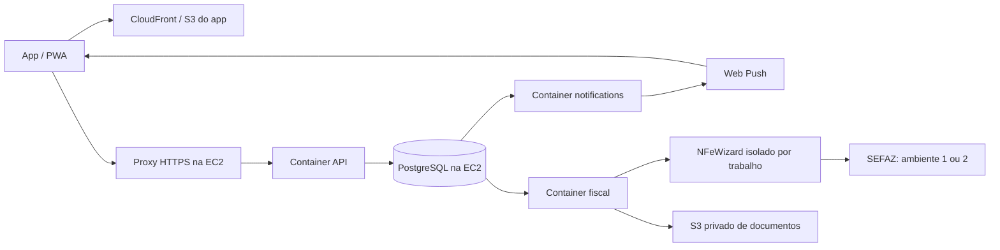

# API, notificações e NFC-e em PostgreSQL

**Atualização de clientes e pedidos:** [entregadores, importador PDF e página pública](CLIENTES-ENTREGAS-PEDIDOS.md). Aplicar também as migrações 008–009 nesta versão.

**Atualização do PDV:** [vendas, caixa, recebimentos, vínculo fiscal e limites restantes](PDV-POSTGRES.md). Aplicar também a migração 007; o app já possui uma tela comercial própria para PostgreSQL.

Implementação de 27/10/2026. Este documento substitui as limitações históricas de workers descritas no diagnóstico anterior. Recursos AWS e emissão real ainda dependem da configuração do ambiente e validação com a SEFAZ.

## Estrutura implementada



O Compose em `compose.production.yml` cria **somente os três containers**. PostgreSQL permanece instalado diretamente na EC2. CloudFront, buckets, domínio, certificado HTTPS e EC2 devem ser provisionados na conta AWS; este repositório não aplica alterações à conta automaticamente. Não usar o Compose antigo da raiz, que atende outro backend.

## Preparação do banco e credenciais

1. Instalar PostgreSQL 17 na EC2, com volume EBS persistente e backup externo com teste de restauração. A porta 5432 não deve estar acessível pela Internet. Permitir em `listen_addresses`/`pg_hba.conf` apenas os endereços privados necessários ao bridge Docker. `host.docker.internal` resolve para o host Linux por `host-gateway`; não resolve um PostgreSQL configurado para escutar somente em 127.0.0.1.
2. Aplicar `npm run db:migrate` por um processo administrativo separado, com `DATABASE_ADMIN_URL`. As migrações 003–006 criam filas, certificados, cadastro fiscal, documentos, numeração e funções de lease, incluindo unicidade de emitente/modelo/série/número entre unidades. A credencial administrativa nunca entra na API ou nos workers.
3. Criar logins individuais, com senhas aleatórias, sem propriedade de tabelas, superuser ou BYPASSRLS. Conceder `bansir_runtime` ao login da API e `bansir_worker` aos logins dos dois workers. Os grupos são NOLOGIN. Exemplo de concessões, após criar os logins via administrador:

```sql
GRANT bansir_runtime TO bansir_api;
GRANT bansir_worker TO bansir_notifications, bansir_fiscal;
```

Os workers usam logins próprios, mas compartilham o grupo técnico `bansir_worker`. Ele permite claim global por funções controladas; leituras e gravações de dados exigem o contexto da unidade do job. O worker de notificações não recebe a chave que descriptografa certificados. Restringir o acesso aos arquivos de ambiente na EC2 e usar volumes/backup criptografados.

4. Copiar `deploy/api.env.example`, `deploy/notifications.env.example` e `deploy/fiscal.env.example` para arquivos com os mesmos nomes sem `.example`. Os arquivos reais são ignorados pelo Git e pelo build Docker. Gerar `FISCAL_ENCRYPTION_KEY` com `node -e "console.log(require('crypto').randomBytes(32).toString('base64'))"`. Guardar essa chave em cofre externo e manter backup: perder a chave impede a recuperação do certificado e do CSC. API e worker fiscal usam a mesma chave; não a trocar sem um procedimento de recriptografia. A cifra identifica a versão `v1` e autentica o contexto empresa/unidade/tipo com AES-256-GCM.
5. Gerar VAPID com `npm run push:keys`, configurar o mesmo par na API e no worker de notificações. O endereço público da API deve estar no app por `VITE_API_URL` no **build**. CORS deve conter a origem HTTPS exata do app.

## Containers e proxy

```sh
docker compose -f compose.production.yml config --quiet
docker compose -f compose.production.yml up -d --build
docker compose -f compose.production.yml ps
docker compose -f compose.production.yml logs --tail=100 api notifications fiscal
```

Imagem Node 24, usuário `node`, filesystem somente leitura, capabilities removidas e `/tmp` em memória. O certificado é materializado em diretório temporário privado apenas no subprocesso fiscal, com arquivo modo 0600. O processo pai também remove o diretório ao concluir ou interromper o subprocesso; se o próprio container for morto abruptamente, o tmpfs é descartado ao recriá-lo. Nunca montar o certificado em bucket público. A API expõe somente 127.0.0.1:5000; instalar proxy HTTPS no host (exemplo em `deploy/nginx-api.conf.example`). Configurar `TRUST_PROXY_HOPS` conforme o caminho real até a API. O limite do proxy permite o upload base64 de até 1 MB de PFX. Workers não publicam portas e encerram após o trabalho atual.

`DATABASE_ENGINE=postgres` é obrigatório na API. Iniciar workers manualmente, se necessário, com `npm run worker:notifications` e `npm run worker:fiscal`. Ambos usam `WORKER_DATABASE_URL`; nunca `DATABASE_ADMIN_URL`.

## App, imagens e XML na AWS

- Bucket do app privado, servido por CloudFront com Origin Access Control; domínio em Route53 e certificado ACM para o domínio do app. Publicar somente `dist/`. Aplicar fallback de rotas SPA para `/index.html`; configurar `/sw.js`, `/index.html` e `/manifest.json` sem cache prolongado, e assets com hash com cache longo. HTTPS é necessário para PWA/push.
- Bucket privado separado para XML, com bloqueio de acesso público e versionamento. O worker escreve `tenants/{tenant}/establishments/{unit}/fiscal/{environment}/{accessKey}.xml`, com SSE-S3 ou SSE-KMS quando `FISCAL_S3_KMS_KEY_ID` estiver configurado. Não compartilhar o domínio/bucket público de imagens com documentos fiscais. O XML também permanece no PostgreSQL para recuperação.
- Conceder ao instance profile da EC2 somente `s3:PutObject` no prefixo fiscal; exemplo de policy em `deploy/fiscal-s3-policy.example.json`. Se usar KMS, conceder também as permissões necessárias na chave e na role. O SDK usa a cadeia padrão de credenciais: preferir IAM role da EC2, sem access key no app ou Git.
- Ao usar IMDSv2 para credenciais da role dentro do Docker, configurar a EC2 com tokens obrigatórios e hop limit compatível com o bridge (normalmente 2); validar a obtenção de credenciais de dentro do container fiscal.
- O código de upload de imagens do catálogo ainda não foi migrado para S3. O armazenamento XML do novo worker está implementado. Não apontar módulos Mongo antigos para o banco novo.

## Certificado e cadastro no app

Em **Configurações → Certificado & NFC-e**, enviar o A1 e-CNPJ `.pfx`/`.p12` e a senha. A API verifica leitura PKCS#12, chave privada correspondente, CNPJ do titular no CN e período de validade. Esta verificação local não substitui a validação da cadeia ICP-Brasil e o credenciamento pela SEFAZ. Certificados e-CPF/A3 não são aceitos por este fluxo.

Depois de salvo o certificado, o cadastro apresenta razão social, nome fantasia, CNPJ, IE, CRT, endereço, código IBGE, CEP, telefone, fuso horário, ambiente, série, próximo número, ID CSC e token CSC. Conferir o fuso da unidade: ele define data/hora e mês da chave, inclusive na virada do mês. O CNPJ deve coincidir com o certificado. O cadastro e o certificado têm chave composta empresa/estabelecimento, RLS e RBAC de configurações. A senha, o arquivo e o CSC nunca voltam nas respostas. O token CSC fica em campo criptografado separado. Para trocar ambiente ou ID do CSC, informar o token correspondente novamente. Se duas unidades lógicas usarem o mesmo CNPJ, configurar séries exclusivas para evitar concorrência de numeração; o banco impede repetição de CNPJ/ambiente/modelo/série/número.

O ambiente 1 é produção e o 2 homologação. Por padrão, `FISCAL_PRODUCTION_ENABLED=false`: salvar o cadastro de produção é permitido, mas enfileirar emissão de produção retorna 409. Após credenciamento, configuração real e validação, definir `true` na **API e no worker fiscal**. O worker exige bucket e região AWS também em homologação, para testar o mesmo caminho de armazenamento. A chave de criptografia é obrigatória para upload e para iniciar o worker fiscal.

## Fila de notificações

`jobs` é uma outbox transacional. A movimentação de saída de estoque com saldo <=5 grava o aviso para o usuário autor da movimentação e enfileira o envio na mesma transação. O PDV PostgreSQL também grava avisos de venda/estoque na transação comercial, com destinatário e chave de evento explícitos. Os demais módulos podem usar `enqueueNotification` ao serem migrados. Não existe broadcast global de todos os usuários.

Em **Configurações → Notificações & PWA**, o usuário ativa este navegador para o estabelecimento atual e pode enviar um teste pela fila. A assinatura é vinculada a usuário, empresa e unidade. Ativar em outra unidade exige uma ação explícita; desativar uma unidade não desativa as demais. O worker revalida vínculos ativos antes do envio. Só são aceitos endpoints HTTPS de FCM, Mozilla Push e Apple Push; outros provedores exigem ampliar a validação de forma controlada.

404/410 desativam a assinatura expirada. Falhas transitórias/429/5xx têm backoff exponencial, até oito tentativas, e depois estado `dead`. A entrega é **pelo menos uma vez**: falhar depois da aceitação pelo provedor pode repetir a mensagem; o `tag` no SW usa o identificador da notificação. O conteúdo push é genérico, e dados de negócio permanecem na caixa privada do usuário/unidade. O clique mantém a sessão fixa; se o aviso pertence a outra unidade, o app oferece voltar à seleção. O usuário continua precisando de autorização para acessar essa unidade.

## Contrato fiscal e limites atuais

- `GET /api/v1/fiscal/settings`: metadados do certificado e configuração sem segredos.
- `POST /api/v1/fiscal/certificate`: `{base64,password}`; limite de 1 MB decodificado.
- `PUT /api/v1/fiscal/settings`: configuração validada e CSC opcional somente para manter o atual no mesmo ambiente/ID.
- `POST /api/v1/fiscal/documents`: `{requestKey: UUID,draft:{det,total,pag,...}}`; exige RBAC `fiscal` ou administrador. Reserva numeração e grava documento+job atomicamente. O servidor monta emitente, chave, número, série, ambiente e identificação. O draft deve conter tributação aprovada pela contabilidade (ICMS, PIS, COFINS e demais campos exigidos pelo schema/SEFAZ). O sistema não presume tributação de GLP. A mesma requestKey com outro conteúdo retorna 409.
- `GET /api/v1/fiscal/documents`: status e protocolo da unidade.
- `GET /api/v1/fiscal/documents/:id/xml`: XML autorizado em resposta JSON autenticada, com nome de arquivo; 409 quando ainda indisponível. Não expõe URL pública do bucket.
- `GET /api/v1/workers/jobs`: últimos 100 jobs da unidade para administradores/configurações; inclui tentativas e erro sanitizado, sem payload/certificado.

O worker usa os SDKs reais `nfewizard-io`/`@nfewizard/nfce`, em subprocesso exclusivo por trabalho; não altera `process.env` para alternar empresas. Grava `submitting` **antes** da chamada. Depois de falha/timeout, o próximo processamento consulta a mesma chave. Não reenvia automaticamente após incerteza nem após uma consulta sem autorização. Mudança de configuração entre enfileiramento e primeira emissão manda o documento para `manual_review`. Revogação do emitente antes da primeira emissão também impede o envio. Uma nota já autorizada só tenta armazenamento S3 nas próximas tentativas.

`manual_review`, fila `dead` e `XML_RECOVERY_REQUIRED` precisam de reconciliação operacional, sem modificar linhas ou reenviar documentos às cegas. Se a SEFAZ confirmou a autorização mas o processo perdeu o XML antes de persistir, o status continua autorizado com protocolo e o job para com `XML_RECOVERY_REQUIRED`; será necessário recuperar o XML por fluxo fiscal próprio. Contingência offline, inutilização, cancelamento, DANFE, distribuição/entrada de NF-e e painel de reconciliação ainda não estão implementados neste novo módulo. O PDV PostgreSQL já vincula a venda paga ao documento da fila, validando os valores; o checkout Mongo legado não participa desse fluxo. Não marcar uma venda como emitida apenas por ter enfileirado o trabalho.

## Validação

`npm run test:postgres` sobe um PostgreSQL descartável, reaplica as migrações e valida RLS/RBAC, certificado, senha incorreta, isolamento, idempotência, concorrência, perda de lease, retry, assinatura expirada, revogação de acesso, ambiente de produção, consulta após timeout e persistência antes do S3. Chamadas SEFAZ, provedor push e S3 são substituídas por adapters de teste; nenhuma nota real é emitida e nenhum dado de produção é usado. O build Docker e o carregamento dos SDKs na imagem são verificações adicionais. Validar a emissão homologada com o certificado real e tributação aprovada antes da liberação operacional.

Resultado local: 19 testes PostgreSQL/filas aprovados; 5 testes de sessão/push do app aprovados; build do app, Compose e carregamento dos SDKs na imagem Docker aprovados. Cadastro conferido em navegador com respostas simuladas, incluindo progressão após upload e viewport móvel. `npm audit` após correções não apontou vulnerabilidades. O lint global do app continua bloqueado por erros anteriores em `CheckoutInvoiceModal.jsx` (Hooks condicionais), além de avisos existentes; os três novos componentes passaram no lint isolado. O build ainda informa chunk maior que 500 kB.
